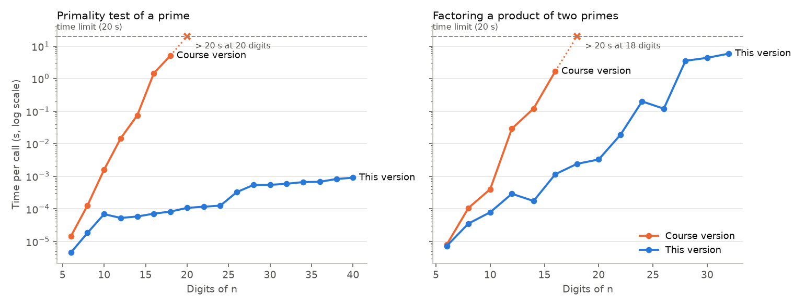

[English](README.md) | **Español**

# Aritmética modular y RSA desde cero

Una librería de teoría de números escrita desde cero en Python puro, un intérprete que resuelve problemas de aritmética modular desde la línea de comandos y un sistema de cifrado RSA construido sobre ella, con un chat cifrado entre dos usuarios y dos ataques contra RSA "de libro".

| Parte | Qué hace |
|---|---|
| **1 · `modular.py`** | Primalidad, listas de primos, factorización, mcd y Bézout, potencias e inversos modulares, φ de Euler, símbolo de Legendre, sistemas de congruencias (teorema chino del resto), raíces cuadradas y ecuaciones cuadráticas módulo p |
| **1 · IMAT-LAB** (`imatlab.py`) | Intérprete de comandos de la librería, en modo interactivo o por lotes: `pow(2,10,7)`, `resolverSistema([1;1;3],[4;7;11])`… |
| **2 · `rsa.py`** | Generación de claves, padding, cifrado y descifrado de texto, ruptura de claves y ataque de texto claro elegido |
| **2 · CriptoChat** | Registro de usuarios con claves RSA y chat cifrado entre dos usuarios |

No usa librerías externas: los algoritmos están implementados a mano sobre los enteros de Python. En los ficheros de benchmark de la asignatura (205.432 comandos) todas las respuestas coinciden con [SymPy](https://www.sympy.org), usado como oráculo independiente, y en mi ordenador todos los ficheros se ejecutan por debajo del tiempo de referencia más exigente de la asignatura ("oro").

> Prácticas 1 y 2 de *Matemática Discreta*, 2.º del Grado en Ingeniería Matemática e Inteligencia Artificial, ICAI – Universidad Pontificia Comillas (2025/26). Trabajo en grupo de **Jimena Zubizarreta** y **Pilar Pérez**. La Práctica 2 se construye sobre la librería de la Práctica 1, por eso las dos están en este repositorio. El código de la Parte 1 tal como se entregó está en [`original/`](original/); esta versión lo amplía (ver [Qué ha cambiado](#qué-ha-cambiado-respecto-a-la-entrega)).


---

## Parte 1 · Librería de aritmética modular e IMAT-LAB

Los prototipos de las funciones los fijaba el enunciado. Algoritmos principales:

| Función | Algoritmo |
|---|---|
| `es_primo(n)` | División por los primos menores que 1.000 y después **Miller–Rabin** con las 12 primeras bases primas, que es determinista para n < 3,3·10²⁴ (por encima añade 20 bases aleatorias) |
| `lista_primos(a, b)` | **Criba de Eratóstenes segmentada** sobre [a, b) |
| `factorizar(n)` | División por primos pequeños y después **rho de Pollard** (variante de Brent) sobre lo que queda |
| `mcd`, `bezout`, `mcd_n`, `bezout_n` | Algoritmo de Euclides y su versión extendida (iterativa) |
| `potencia_mod_p(b, e, p)` | Exponenciación rápida; exponentes negativos mediante el inverso modular |
| `inversa_mod_p(n, p)` | Euclides extendido (Bézout) |
| `euler(n)` | Fórmula del producto φ(n) = n ∏(1 − 1/p) sobre la factorización |
| `legendre(n, p)` | Criterio de Euler n^((p−1)/2) mod p |
| `resolver_sistema_congruencias` | **Teorema chino del resto generalizado**: cada a·x ≡ b (mod p) se reduce a x ≡ r (mod p/d) y se combinan de dos en dos; los módulos **no** tienen que ser coprimos |
| `raiz_mod_p(n, p)` | n^((p+1)/4) si p ≡ 3 (mod 4); **algoritmo de Cipolla** en otro caso |
| `ecuacion_cuadratica(a, b, c, p)` | Fórmula de la ecuación de segundo grado módulo p, con `raiz_mod_p` para el discriminante |

**IMAT-LAB** lee un comando por línea hasta encontrar una línea vacía. En modo por lotes escribe la respuesta, `NE` (no existe solución) o `NOP` (llamada incorrecta), exactamente como pide el enunciado; en modo interactivo explica el error (`NE: no existe inversa`). Ninguna entrada puede hacer que falle.

```
$ python imatlab.py
>> resolverSistema([1;1;3],[4;7;11])
10 (mod 33)
>> inv(3,9)
NE: no existe inversa
>> factorizar(28282590191348679547)
4634630887: 1, 6102447181: 1
```

### Rendimiento

La asignatura proporcionaba 8 ficheros de benchmark y tres tiempos de referencia para cada uno (bronce, plata y oro, medidos en los ordenadores de los laboratorios de ICAI). Media de 5 ejecuciones en mi ordenador (`python scripts/benchmark.py --compare-original`), así que la comparación con la referencia es solo aproximada:

| Fichero | Comandos | Referencia oro | Versión entregada | Esta versión |
|---|---|---|---|---|
| primosTest | 109.999 | 0,73 s | 1,73 s (plata) | **0,44 s** |
| factorTest | 1.048 | 1,99 s | 0,92 s | **0,045 s** |
| mcdTest | 39.501 | 1,00 s | 0,72 s | 0,73 s |
| potenciaTest | 6.997 | 0,12 s | 0,091 s | 0,095 s |
| invTest | 41.499 | 3,13 s | 2,41 s | **1,67 s** |
| eulerTest | 999 | 0,78 s | 0,33 s | **0,033 s** |
| sistemaTest | 1.391 | 0,99 s | 0,020 s, pero 113 respuestas erróneas | 0,022 s, todas correctas |
| cuadraticaTest | 3.998 | 0,22 s | no implementado | **0,051 s** |

Los ficheros de la asignatura solo usan números de hasta unas 10 cifras. La diferencia aparece con números más grandes: la división por tentativa necesita unos √n pasos, mientras que Miller–Rabin y la rho de Pollard necesitan del orden de log n y n^¼.

<p align="center">
  
</p>

- **Primalidad:** la versión entregada tarda 5 s con un primo de 18 cifras y más de 20 s a partir de 20 cifras; esta versión comprueba un primo de 40 cifras en menos de 1 ms.
- **Factorización:** la versión entregada supera el límite de 20 s con 18 cifras; factorizar el módulo de 20 cifras del reto RSA de la Parte 2 le llevaría muchos minutos. Esta versión factoriza ese módulo en unos 20 ms y números de 32 cifras en 6 s. El tiempo crece con el tamaño del menor factor primo, y por eso las claves RSA reales (más de 600 cifras) no se pueden romper así.

## Parte 2 · RSA y CriptoChat

`rsa.py` implementa RSA "de libro" sobre `modular.py`:

1. **Claves.** `generar_claves(min, max)` elige dos primos distintos p, q en [min, max), calcula n = pq y φ(n) = (p−1)(q−1), toma e = 65537 (o un e aleatorio coprimo con φ(n) si la clave es muy pequeña) y d = e⁻¹ mod φ(n).
2. **Padding.** Antes de cifrar se añaden `k` cifras aleatorias al mensaje: m → m·10ᵏ + aleatorio. Al descifrar se eliminan.
3. **Texto.** Cada carácter se cifra por separado a partir de su código Unicode: c = (código con padding)ᵉ mod n.
4. **Romper la clave.** `romper_clave(n, e)` factoriza n, calcula φ(n) y recupera d. Con la rho de Pollard tarda milisegundos con los módulos de unas 20 cifras de la asignatura.
5. **Ataque de texto claro elegido.** Sin padding, cada carácter se cifra siempre en el mismo número. `ataque_texto_elegido` cifra todos los caracteres posibles con la clave *pública* y busca cada número del mensaje, así que lo descifra sin llegar a conocer d.

**El reto de la asignatura.** La asignatura daba una clave pública (n de 20 cifras) y un mensaje de 759 caracteres cifrado sin padding ([`data/reto_X.txt`](data/reto_X.txt)). `python romper_reto.py` lo rompe de las dos formas y comprueba que coinciden: el ataque de texto elegido tarda ≈ 2 ms (el mensaje solo tiene 37 números distintos) y factorizar n = 4.634.630.887 × 6.102.447.181 para recuperar d, ≈ 70 ms. El texto es un fragmento literario en español.

**CriptoChat.** `registrarusuario.py` crea las claves de un usuario (`Usuarios/pub_<nombre>.txt` con n, e y las cifras de padding, y `Usuarios/priv_<nombre>.txt` con d). `criptochat.py ana luis` permite a Ana cifrar mensajes para Luis con su clave pública y descifrar los que recibe con su clave privada.

> Es RSA tal como se enseña en la asignatura, no para uso real: cifrar carácter a carácter y un padding tan simple son inseguros, y las claves de este tamaño se rompen en milisegundos, como muestra el reto.

## Estructura del repositorio

```
modular-arithmetic-rsa/
├── modular.py            # Parte 1: librería de teoría de números
├── imatlab.py            # Parte 1: intérprete IMAT-LAB (interactivo y por lotes)
├── excepciones.py        # NE, NOP e IncompatibleEquationError
├── rsa.py                # Parte 2: librería RSA
├── registrarusuario.py   # Parte 2: crea las claves RSA de un usuario
├── criptochat.py         # Parte 2: chat cifrado entre dos usuarios
├── romper_reto.py        # Parte 2: rompe el reto RSA de la asignatura
├── examples/             # Comandos de ejemplo y salida esperada (asignatura) + ejemplos extra
├── benchmarks/           # Los 8 ficheros de benchmark de la asignatura
├── data/reto_X.txt       # Reto RSA de la asignatura
├── scripts/
│   ├── benchmark.py          # Tiempos con los benchmarks frente a los de referencia
│   ├── check_with_sympy.py   # Comprueba cada respuesta de los benchmarks con SymPy
│   └── scaling.py            # Figura: tiempo según el número de cifras
├── tests/                # pytest: tests unitarios, del intérprete, de RSA y basados en propiedades
├── original/             # Entrega de la asignatura: librería de la Parte 1 y scripts del chat de la Parte 2
├── report/practica1_report_es.pdf   # Memoria de la Parte 1
└── docs/                 # Figuras y resultados en CSV
```

## Cómo reproducir los resultados

**Requisitos:** Python 3.12. Los programas solo usan la librería estándar; `requirements.txt` añade pytest, Hypothesis, SymPy y Matplotlib para los tests y las figuras.

1. **Clonar el repositorio e instalar las dependencias**
   ```bash
   git clone https://github.com/jimenazubii/modular-arithmetic-rsa.git
   cd modular-arithmetic-rsa
   python3.12 -m venv .venv
   source .venv/bin/activate          # Windows: .venv\Scripts\activate
   pip install -r requirements.txt
   ```

2. **Usar IMAT-LAB**
   ```bash
   python imatlab.py                                          # modo interactivo (línea vacía para salir)
   python imatlab.py examples/ejemplosComandos.txt salida.txt # modo por lotes
   diff salida.txt examples/ejemplosSalida.txt                # sin salida: idéntico al fichero esperado
   ```
   Comandos: `primo(n)`, `primos(a,b)`, `factorizar(n)`, `mcd(a,b,...)`, `coprimos(a,b)`, `bezout(a,b)`, `pow(b,e,p)`, `inv(n,p)`, `euler(n)`, `legendre(n,p)`, `resolverSistema([a1;b1;p1],[a2;b2;p2],...)`, `raiz(n,p)`, `ecCuadratica(a,b,c,p)`.

3. **Usar RSA**
   ```bash
   python romper_reto.py                                   # rompe el reto de la asignatura
   python registrarusuario.py ana 1000000 10000000 3       # nombre, primo mínimo, primo máximo, cifras de padding
   python registrarusuario.py luis 1000000 10000000 3
   python criptochat.py ana luis                           # C para cifrar, D para descifrar, S para salir
   ```
   Las claves se guardan en `Usuarios/`, que git ignora porque contiene claves privadas.

4. **Ejecutar los tests** (unos 15 s)
   ```bash
   python -m pytest
   ```
   288 tests: los casos de los tests de la asignatura, casos límite (números de Carmichael, primos de Mersenne, sistemas con módulos no coprimos, el peor caso de Euclides), cifrado y descifrado con padding y tildes, los dos ataques y tests basados en propiedades que comparan `modular.py` con SymPy sobre entradas aleatorias.

5. **Reproducir las cifras y la figura**
   ```bash
   python scripts/check_with_sympy.py                      # 0 discrepancias en 205.432 comandos
   python scripts/check_with_sympy.py --code original/practica1   # versión entregada: 113 + 3.998 discrepancias
   python scripts/benchmark.py --compare-original          # tabla de arriba → docs/benchmark.csv
   python scripts/scaling.py                               # ≈ 5 min → docs/figures/scaling.png
   ```
   Los tiempos dependen del ordenador; las respuestas, no.

## Qué ha cambiado respecto a la entrega

La Parte 1 es el código que entregamos (en [`original/practica1/`](original/practica1/)), revisado y ampliado. Sus funciones obligatorias ya eran correctas en los benchmarks de la asignatura; lo que ha cambiado:

| Versión entregada | Esta versión |
|---|---|
| División por tentativa para la primalidad y la factorización: inviable a partir de 18–20 cifras. | Miller–Rabin y rho de Pollard: un primo de 40 cifras se comprueba en 1 ms (ver la figura). |
| `lista_primos` comprobaba cada número por separado con división por tentativa. | Criba de Eratóstenes segmentada; junto con Miller–Rabin, `primosTest` va 4 veces más rápido y llega al tiempo oro. |
| Los sistemas de congruencias exigían módulos coprimos (113 sistemas del benchmark se daban por incompatibles sin serlo). | Teorema chino del resto generalizado (ejercicio opcional 12). |
| Raíces cuadradas y ecuaciones cuadráticas módulo p sin implementar (ejercicios opcionales 13–14). | Implementadas con el algoritmo de Cipolla y comprobadas con SymPy en las 3.998 ecuaciones del benchmark. |
| Errores: `pow(0,5,7)` y `pow(5,0,7)` daban error; `factorizar(1)` escribía `NE` en vez de `1`; `mcd(-4)` devolvía −4; `legendre(3,2)` y `resolverSistema(1,2,3)` hacían fallar el intérprete. | Corregidos; cualquier error inesperado se escribe como `NOP`, como pide el enunciado. |
| El modo por lotes escribía el detalle del error (`NE: no existe inversa`) en vez del código. | Códigos solos en modo por lotes (salida idéntica al fichero esperado de la asignatura) y detalle en modo interactivo. |
| Euclides extendido recursivo. | Iterativo, para no chocar con el límite de recursión de Python. |
| Tres ficheros de tests de la asignatura no llegaban a ejecutarse (faltaban comas y pytest fallaba al cargarlos). | Nueva batería de 288 tests y un script que comprueba cada respuesta de los benchmarks con SymPy. |

En la Parte 2, `rsa.py` se ha **reescrito** para este repositorio manteniendo los prototipos del enunciado: generación de claves con primos aleatorios y Miller–Rabin (la versión entregada listaba todos los primos del intervalo), e = 65537, padding con la fuente de aleatoriedad del sistema operativo, un error cuando un carácter con padding no cabe en n (antes se cifraba en algo imposible de descifrar), excepciones en vez de mensajes por pantalla y ruptura de claves con la rho de Pollard. Los scripts de registro y de chat son los de la entrega con validación de entradas y gestión de errores.

## Autoras

**Jimena Zubizarreta** y **Pilar Pérez**, Grado en Ingeniería Matemática e Inteligencia Artificial, ICAI – Universidad Pontificia Comillas, Madrid. Los enunciados, los prototipos de las funciones, los ficheros de benchmark, los ejemplos y el reto RSA son de la asignatura.
