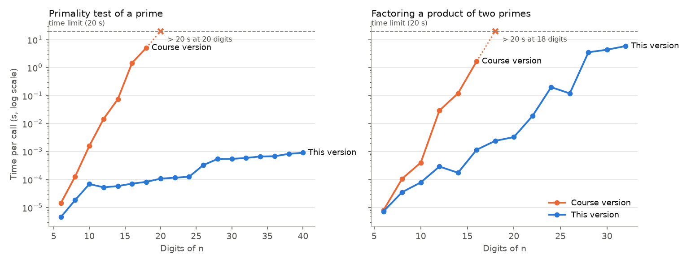

**English** | [Español](README.es.md)

# Modular Arithmetic & RSA from Scratch

A number-theory library written from scratch in pure Python, an interpreter that solves modular-arithmetic problems from the command line, and an RSA encryption system built on top of it, with an encrypted two-user chat and two attacks against textbook RSA.

| Part | What it does |
|---|---|
| **1 · `modular.py`** | Primality, prime lists, factorisation, gcd and Bézout, modular powers and inverses, Euler's φ, the Legendre symbol, systems of congruences (Chinese remainder theorem), square roots and quadratic equations mod p |
| **1 · IMAT-LAB** (`imatlab.py`) | Command interpreter for the library, in interactive or batch mode: `pow(2,10,7)`, `resolverSistema([1;1;3],[4;7;11])`… |
| **2 · `rsa.py`** | Key generation, padding, encryption and decryption of text, key breaking and a chosen-plaintext attack |
| **2 · CriptoChat** | User registration with RSA keys and an encrypted chat between two users |

No external libraries are used: the algorithms are implemented by hand on top of Python's integers. On the course's benchmark files (205,432 commands) every answer matches [SymPy](https://www.sympy.org) used as an independent oracle, and on my machine every file runs within the course's fastest reference time ("gold").

> Practical assignments 1 and 2 of *Discrete Mathematics (Matemática Discreta)*, 2nd year of the BSc in Mathematical Engineering and Artificial Intelligence, ICAI – Universidad Pontificia Comillas (2025/26). Group work by **Jimena Zubizarreta** and **Pilar Pérez**. Assignment 2 builds on the library from assignment 1, so both live in this repository. The Part 1 code as submitted is kept in [`original/`](original/); this version extends it (see [What changed](#what-changed-since-the-course-submission)).


---

## Part 1 · Modular arithmetic library and IMAT-LAB

The function signatures were fixed by the assignment (Spanish names). The main algorithms:

| Function | Algorithm |
|---|---|
| `es_primo(n)` | Division by the primes below 1,000, then **Miller–Rabin** with the first 12 prime bases, which is deterministic for n < 3.3·10²⁴ (20 extra random bases above that) |
| `lista_primos(a, b)` | **Segmented sieve of Eratosthenes** on [a, b) |
| `factorizar(n)` | Trial division by small primes, then **Pollard's rho** (Brent's variant) on what is left |
| `mcd`, `bezout`, `mcd_n`, `bezout_n` | Euclid's algorithm and its extended version (iterative) |
| `potencia_mod_p(b, e, p)` | Square-and-multiply; negative exponents through the modular inverse |
| `inversa_mod_p(n, p)` | Extended Euclid (Bézout) |
| `euler(n)` | Product formula φ(n) = n ∏(1 − 1/p) over the factorisation |
| `legendre(n, p)` | Euler's criterion n^((p−1)/2) mod p |
| `resolver_sistema_congruencias` | Generalised **Chinese remainder theorem**: each a·x ≡ b (mod p) is reduced to x ≡ r (mod p/d), then they are combined two at a time; the moduli **do not** need to be coprime |
| `raiz_mod_p(n, p)` | n^((p+1)/4) when p ≡ 3 (mod 4), **Cipolla's algorithm** otherwise |
| `ecuacion_cuadratica(a, b, c, p)` | Quadratic formula mod p, using `raiz_mod_p` for the discriminant |

**IMAT-LAB** reads one command per line until an empty line. In batch mode it prints the answer, `NE` (no solution) or `NOP` (bad call), exactly as the assignment specifies; in interactive mode it explains the error (`NE: no existe inversa`). No input can crash it.

```
$ python imatlab.py
>> resolverSistema([1;1;3],[4;7;11])
10 (mod 33)
>> inv(3,9)
NE: no existe inversa
>> factorizar(28282590191348679547)
4634630887: 1, 6102447181: 1
```

### Performance

The course provided 8 benchmark files and three reference times for each (bronze, silver, gold, measured on the ICAI lab computers). Mean of 5 runs on my machine (`python scripts/benchmark.py --compare-original`), so the comparison with the reference is only approximate:

| Benchmark file | Commands | Gold reference | Course version | This version |
|---|---|---|---|---|
| primosTest | 109,999 | 0.73 s | 1.73 s (silver) | **0.44 s** |
| factorTest | 1,048 | 1.99 s | 0.92 s | **0.045 s** |
| mcdTest | 39,501 | 1.00 s | 0.72 s | 0.73 s |
| potenciaTest | 6,997 | 0.12 s | 0.091 s | 0.095 s |
| invTest | 41,499 | 3.13 s | 2.41 s | **1.67 s** |
| eulerTest | 999 | 0.78 s | 0.33 s | **0.033 s** |
| sistemaTest | 1,391 | 0.99 s | 0.020 s, but 113 wrong answers | 0.022 s, all correct |
| cuadraticaTest | 3,998 | 0.22 s | not implemented | **0.051 s** |

The course files only exercise numbers of up to ~10 digits. The difference shows with larger numbers: trial division needs about √n steps, while Miller–Rabin and Pollard's rho need roughly log n and n^¼ steps.

<p align="center">
  
</p>

- **Primality:** the course version needs 5 s for an 18-digit prime and more than 20 s from 20 digits on; this version tests a 40-digit prime in under 1 ms.
- **Factorisation:** the course version passes the 20 s limit at 18 digits; factoring the 20-digit modulus of the RSA challenge in Part 2 would take it many minutes. This version factors that modulus in about 20 ms and handles 32-digit numbers in 6 s. The time grows with the size of the smallest prime factor, which is why real RSA keys (600+ digits) cannot be broken this way.

## Part 2 · RSA and CriptoChat

`rsa.py` implements textbook RSA on top of `modular.py`:

1. **Keys.** `generar_claves(min, max)` picks two distinct primes p, q in [min, max), sets n = pq and φ(n) = (p−1)(q−1), takes e = 65537 (or a random e coprime with φ(n) for very small keys) and d = e⁻¹ mod φ(n).
2. **Padding.** Before encrypting, `k` random digits are appended to the message: m → m·10ᵏ + random. Decryption drops them again.
3. **Text.** Each character is encrypted separately from its Unicode code: c = (padded code)ᵉ mod n.
4. **Breaking the key.** `romper_clave(n, e)` factors n, computes φ(n) and recovers d. With Pollard's rho this takes milliseconds for the ~20-digit moduli of the course.
5. **Chosen-plaintext attack.** Without padding, each character always encrypts to the same number. `ataque_texto_elegido` encrypts every possible character with the *public* key and looks the ciphertext up, so it decrypts without ever finding d.

**The course challenge.** The course gave a public key (n with 20 digits) and a 759-character message encrypted without padding ([`data/reto_X.txt`](data/reto_X.txt)). `python romper_reto.py` breaks it both ways and checks that they agree: the chosen-plaintext attack takes ≈ 2 ms (the message only has 37 distinct numbers), and factoring n = 4,634,630,887 × 6,102,447,181 to recover d takes ≈ 70 ms. The plaintext is a Spanish literary passage.

**CriptoChat.** `registrarusuario.py` creates a user's keys (`Usuarios/pub_<name>.txt` with n, e and the padding digits, `Usuarios/priv_<name>.txt` with d). `criptochat.py ana luis` lets Ana encrypt messages for Luis with his public key and decrypt the ones she receives with her private key.

> This is RSA as taught in a course, not for real use: encrypting character by character and the simple padding are insecure, and keys of this size can be broken in milliseconds, as the challenge shows.

## Repository structure

```
modular-arithmetic-rsa/
├── modular.py            # Part 1: number-theory library
├── imatlab.py            # Part 1: IMAT-LAB interpreter (interactive and batch)
├── excepciones.py        # NE, NOP and IncompatibleEquationError
├── rsa.py                # Part 2: RSA library
├── registrarusuario.py   # Part 2: create a user's RSA keys
├── criptochat.py         # Part 2: encrypted chat between two users
├── romper_reto.py        # Part 2: break the course's RSA challenge
├── examples/             # Example commands and expected output (course) + extra examples
├── benchmarks/           # The course's 8 benchmark input files
├── data/reto_X.txt       # RSA challenge from the course
├── scripts/
│   ├── benchmark.py          # Times on the benchmark files vs the reference times
│   ├── check_with_sympy.py   # Checks every benchmark answer against SymPy
│   └── scaling.py            # Figure: time against number of digits
├── tests/                # pytest: unit, interpreter, RSA and property-based tests
├── original/             # Course submission: Part 1 library and Part 2 chat scripts
├── report/practica1_report_es.pdf   # Part 1 report (Spanish)
└── docs/                 # Figures and CSV results
```

## How to reproduce the results

**Requirements:** Python 3.12. The programs themselves only use the standard library; `requirements.txt` adds pytest, Hypothesis, SymPy and Matplotlib for the tests and figures.

1. **Clone the repository and install the dependencies**
   ```bash
   git clone https://github.com/jimenazubii/modular-arithmetic-rsa.git
   cd modular-arithmetic-rsa
   python3.12 -m venv .venv
   source .venv/bin/activate          # Windows: .venv\Scripts\activate
   pip install -r requirements.txt
   ```

2. **Use IMAT-LAB**
   ```bash
   python imatlab.py                                          # interactive mode (empty line to quit)
   python imatlab.py examples/ejemplosComandos.txt salida.txt # batch mode
   diff salida.txt examples/ejemplosSalida.txt                # no output: identical to the expected file
   ```
   Commands: `primo(n)`, `primos(a,b)`, `factorizar(n)`, `mcd(a,b,...)`, `coprimos(a,b)`, `bezout(a,b)`, `pow(b,e,p)`, `inv(n,p)`, `euler(n)`, `legendre(n,p)`, `resolverSistema([a1;b1;p1],[a2;b2;p2],...)`, `raiz(n,p)`, `ecCuadratica(a,b,c,p)`.

3. **Use RSA**
   ```bash
   python romper_reto.py                                   # break the course challenge
   python registrarusuario.py ana 1000000 10000000 3       # name, min prime, max prime, padding digits
   python registrarusuario.py luis 1000000 10000000 3
   python criptochat.py ana luis                           # C to encrypt, D to decrypt, S to quit
   ```
   Keys are written to `Usuarios/`, which git ignores because it contains private keys.

4. **Run the tests** (about 15 s)
   ```bash
   python -m pytest
   ```
   288 tests: the cases from the course tests, edge cases (Carmichael numbers, Mersenne primes, non-coprime systems, Euclid's worst case), RSA round trips with padding and accents, both attacks, and property-based tests that compare `modular.py` with SymPy on random inputs.

5. **Reproduce the numbers and the figure**
   ```bash
   python scripts/check_with_sympy.py                      # 0 mismatches on 205,432 commands
   python scripts/check_with_sympy.py --code original/practica1   # course version: 113 + 3,998 mismatches
   python scripts/benchmark.py --compare-original          # table above → docs/benchmark.csv
   python scripts/scaling.py                               # ≈ 5 min → docs/figures/scaling.png
   ```
   Times depend on the machine; the answers do not.

## What changed since the course submission

Part 1 is the code we submitted (in [`original/practica1/`](original/practica1/)), reviewed and extended. Its required functions were already correct on the course benchmarks; what changed:

| Course version | This version |
|---|---|
| Trial division for primality and factorisation: impractical beyond ~18–20 digits. | Miller–Rabin and Pollard's rho: 40-digit primes are tested in about 1 ms (see the figure). |
| `lista_primos` tested each number separately with trial division. | Segmented sieve of Eratosthenes; with Miller–Rabin, `primosTest` runs 4× faster and reaches the gold time. |
| Systems of congruences required coprime moduli (113 benchmark systems were wrongly reported as having no solution). | Generalised Chinese remainder theorem (optional exercise 12). |
| Square roots and quadratic equations mod p not implemented (optional exercises 13–14). | Implemented with Cipolla's algorithm, and checked against SymPy on all 3,998 benchmark equations. |
| Bugs: `pow(0,5,7)` and `pow(5,0,7)` returned an error; `factorizar(1)` printed `NE` instead of `1`; `mcd(-4)` returned −4; `legendre(3,2)` and `resolverSistema(1,2,3)` crashed the interpreter. | Fixed; any unexpected error is now reported as `NOP`, as the assignment requires. |
| Batch mode printed error details (`NE: no existe inversa`) instead of the plain codes. | Plain codes in batch mode (output identical to the course's expected file) and details in interactive mode. |
| Recursive extended Euclid. | Iterative, so it cannot hit Python's recursion limit. |
| Three of the course test files did not run (missing commas made pytest fail while collecting them). | New test suite of 288 tests, plus a script that checks every benchmark answer against SymPy. |

For Part 2, `rsa.py` was **rewritten** for this repository, keeping the assignment's signatures: random-prime key generation with Miller–Rabin (the course version listed every prime in the interval), e = 65537, padding from the operating system's random source, an error when a padded character does not fit in n (it used to be encrypted into something that could never be decrypted), exceptions instead of printed messages, and key breaking through Pollard's rho. The registration and chat scripts are the course ones with input validation and error handling added.

## Authors

**Jimena Zubizarreta** and **Pilar Pérez**, BSc in Mathematical Engineering and Artificial Intelligence, ICAI – Universidad Pontificia Comillas, Madrid. The problem statements, function signatures, benchmark files, examples and the RSA challenge come from the course.
